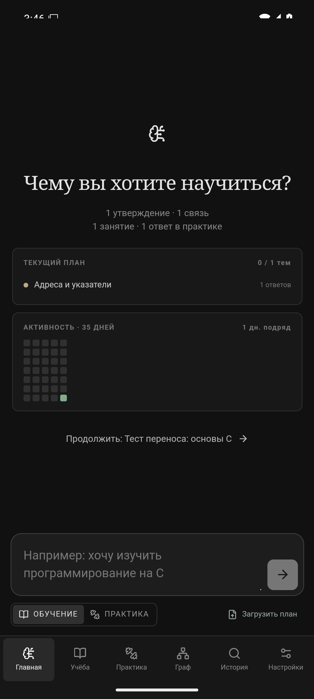

# educatioHarness

Локальное настольное приложение для персонального обучения с настоящими вызовами ИИ. Основа — Tauri 2, React, SQLite и отдельный Node.js runtime. Интерфейс на русском языке.




## Запуск на Linux, Windows и macOS

Нужны Node.js 22+, Rust stable и системные библиотеки Tauri 2. На Linux: WebKitGTK 4.1, GTK 3, libsoup 3, pkg-config и Secret Service (GNOME Keyring или KWallet). На Windows: Microsoft C++ Build Tools и WebView2; на macOS: Xcode Command Line Tools. Подробнее: [системные зависимости Tauri](https://v2.tauri.app/start/prerequisites/). Для ChatGPT приложение комплектуется официальным бинарником Codex и использует его штатный вход; существующая сессия `codex login` также доступна. Для альтернативы нужен OpenAI API-ключ.

```sh
npm install
npm run tauri dev
```

В проверенной Hyprland-сессии WebKitGTK не отрисовывал Wayland-окно из-за ошибки GBM. Приложение автоматически включает XWayland и программную отрисовку только в Hyprland; на других рабочих столах остаются обычные настройки GTK. Сборка runtime выполняется автоматически перед запуском.

После подключения ИИ введите цель прямо на главном экране, ответьте на диагностические вопросы, изучите план, выберите тему и продолжите диалог. Для той же цели можно открыть «Новое занятие»: учитель получит историю этой цели из прежних занятий, а чужие цели в контекст не попадут. «Практика» создаёт задания и сохраняет обратную связь. «Граф знаний» показывает извлечённые утверждения, их связи, фильтр по теме и исходные реплики с переходом к занятию. Компактная колонка занятий и минималистичный тёмный экран повторяют структуру LearnHarness; подписи и учебный сценарий — на русском. В узком окне (от 340 px) вместо боковой колонки появляются нижняя навигация и выдвижной план обучения. Данные находятся в локальном каталоге приложений ОС (`educatio-harness/educatio-harness.sqlite3`); ключ API хранится в Secret Service, macOS Keychain или Windows Credential Manager, а состояние входа ChatGPT — у официального Codex CLI.

В плане можно раскрыть «Настроить тему» и изменить название, описание, цели, сложность, статус и предпосылки из предыдущих тем маршрута. Удаление темы, от которой зависят другие, блокируется до ручного изменения их предпосылок. Ручная правка плана не является новой оценкой знаний моделью.

Если построение плана прервётся после оценки диагностических ответов, кнопка «Продолжить» использует сохранённую оценку и повторяет только незавершённый шаг. При изменении ответов оценка выполняется заново.

В практике есть карточки на активное вспоминание: вопрос и разбор разделены, ответ проверяется моделью только после отправки. Написанный ответ сохраняется до вызова модели; если проверка прервалась, его можно открыть и проверить снова после перезапуска, не раскрывая решение. «Итоговое повторение» создаёт до трёх вопросов из разных изученных тем, скрывает название темы до проверки ответа и сохраняет набор как workflow: после сбоя можно продолжить генерацию без повторения уже сохранённых вопросов, а после перезапуска — закончить ответы и открыть сохранённые разборы. Кодовые задания открывают редактор CodeMirror с подсветкой, отступами и нумерацией строк; математические ответы показывают предпросмотр Markdown/KaTeX. Главный экран показывает состояние тем, карту активности за 35 дней, серию дней с занятиями или ответами и подсказку повторить тему после давнего или затруднительного ответа. Интервалы повторения — простая рекомендация, а не процент усвоения. Карточки и редактор используют настоящие модельные задания, не демонстрационные ответы.

В «Настройки → Перенос данных» основной вариант — защищённый архив `.ehb` с паролем от 12 символов. База копируется через SQLite Online Backup, шифруется ChaCha20-Poly1305 с ключом, полученным Argon2id (64 МиБ, 3 прохода), и проверяется при открытии. Пароль не сохраняется; потерянный пароль восстановить нельзя. Архивы ограничены 100 МБ. Экспорт не перезаписывает существующие `.ehb` или `.sqlite3` — выберите новое имя. Обычный `.sqlite3` без шифрования остаётся в раскрывающемся разделе для совместимости и локальных резервных копий; не пересылайте его без дополнительной защиты.

Перед любым импортом приложение проверяет целостность, версию и точную схему базы, показывает количество целей/занятий/ответов, спрашивает подтверждение и автоматически сохраняет прежнюю базу в локальном каталоге. Архивы схемы 2–4 обновляются до схемы 5; файлы с изменёнными таблицами или триггерами отклоняются. Импорт заменяет текущие данные. Ключ API и сессия ChatGPT не экспортируются; каталоги пользовательских навыков после импорта нужно выбрать заново. Временная расшифрованная копия создаётся в каталоге приложения только на время проверки и импорта и удаляется после операции.

Для передачи через свой сервер запустите [sync-server](docs/sync-server.md), затем в «Настройки → Свой сервер» укажите HTTPS-адрес и токен. Можно отправить подготовленный `.ehb`; на другом компьютере используйте «Скачать и развернуть данные» с паролем. Отдельная кнопка «Скачать .ehb» сохраняет резервный файл, но не разрешает перезаписать сервер: версия считается принятой только после успешного импорта. Перед отправкой приложение проверяет пароль и схему; архивный endpoint видит только зашифрованные байты. Это ручной перенос без автоматического объединения изменений; при конфликте загрузка не перезаписывает более новую версию без проверки. Провайдер, модель и идентификаторы сессий ИИ не переносятся с учебной базой. Необязательный AI-endpoint сервера, в отличие от архива, получает открытый текст учебных запросов. Сервер может использовать собственный OpenAI API-ключ или официальную сессию Codex CLI на доверенной серверной машине; учётная запись пользователя телефона не передаётся серверу. На телефоне подключение требует настоящего ответа модели: один только архивный endpoint не считается подключённым ИИ. После включения endpoint desktop-клиент может выбрать «Свой сервер» в настройках провайдера ИИ.

В «Настройки → Каталог данных» можно перенести живую базу в другой существующий каталог. Приложение создаёт в нём папку `educatioHarness`, копирует данные через SQLite backup и перезапускается; прежний файл остаётся для восстановления. Если в месте назначения уже есть база, перенос останавливается без перезаписи. При недоступном выбранном каталоге запуск останавливается с ошибкой вместо создания пустой базы.

Готовый учебный план можно загрузить в «Обучение» из `.md` или `.txt` (в том числе заметку из Obsidian) либо вставить его текст: перед отправкой модели он виден и редактируем. Модель сохраняет темы и связи в учебной базе без фиктивной диагностики; источник остаётся нетронутым. В настройках есть экспорт в Obsidian: приложение создаёт отдельную папку с Markdown-заметками по целям, темам и узлам графа и добавляет внутренние ссылки, которые Obsidian показывает как связи. Существующие заметки не перезаписываются. Это импорт отдельного файла и односторонний экспорт, не двусторонняя синхронизация хранилища. Формат внутренних ссылок соответствует [документации Obsidian](https://obsidian.md/help/links); [Graph view](https://obsidian.md/help/plugins/graph) строится по этим ссылкам.

В настройках провайдер и модель выбираются компактными тёмными переключателями, а обычные поля ввода и списки оформлены единообразно. Для ChatGPT доступны автоматический выбор Codex либо Sol, Terra и Luna; для OpenAI API — Sol, Terra либо Luna. Доступность конкретной модели зависит от аккаунта; переключение не обещает доступ, а тест подключения выполняет реальный запрос. Локальный профиль хранит имя и статистику учёбы в базе приложения и переносится вместе с защищённым архивом; отдельного серверного аккаунта пока нет.

Новый API-ключ сначала проверяется настоящим запросом Responses API к выбранной модели и лишь после успешного ответа сохраняется в системном хранилище секретов. При ошибке прежний сохранённый ключ не заменяется; сам ключ не записывается в SQLite и не выводится в журнал.

## Проверки и сборка

```sh
npm run typecheck
npm test
cargo test --manifest-path src-tauri/Cargo.toml
npm run desktop:build
```

`desktop:build` собирает исполняемые Node.js и официальный Codex sidecar для текущего Rust host: на Linux — `.deb` и AppImage, на Windows — NSIS `.exe`, на macOS — `.app` и `.dmg`. Для RPM используйте `npm run desktop:build:rpm`. [CI](.github/workflows/desktop.yml) проверен на трёх host-ОС: [прогон 43012286707](https://github.com/Artyx71/educatioHarness/actions/runs/43012286707) завершился успешно и загрузил Linux `.deb`/AppImage/RPM, Windows NSIS `.exe` и macOS `.app`/`.dmg`. Это проверка сборки и тестов, не интерактивный прогон приложения на Windows/macOS. Сборка другой архитектуры должна выполняться на соответствующем host, простое копирование Node.exe/бинарника Codex для cross-compile не годится. Исходники LearnHarness в `.references/learnharness` исключены из сборки. Codex запускается с `read-only`, без сетевых инструментов и с запретом запросов на повышенные права. Это не полная файловая изоляция: встроенные инструменты Codex могут читать доступные процессу локальные файлы. OpenAI Responses API в приложении вызывается без локальных инструментов.

## Документация

- [Архитектура](docs/architecture.md)
- [Разработка](docs/development.md)
- [Разработка по спецификациям](docs/spec-driven.md)
- [Участие в проекте](CONTRIBUTING.md)
- [Навыки](docs/skills.md)
- [Повторное использование LearnHarness](docs/upstream-reuse.md)
- [Исследование и следующие функции](docs/product-roadmap.md)

Проект использует идеи и адаптированные формулировки LearnHarness, лицензированного AGPL-3.0-only. См. [LICENSE](LICENSE) и [upstream-reuse.md](docs/upstream-reuse.md).

## Ограничения

Desktop-MVP запускает отдельный Node.js процесс на запрос. Запрос можно отменить; потоковые события отображаются как прогресс, но текст структурированного ответа показывается только после проверки схемы, чтобы не раскрывать решения заданий раньше времени. Оценка упражнений моделью — объяснённое суждение, а не формальное доказательство; кодовые ответы не исполняются. Для API-ключа нужен работающий системный менеджер секретов; вход с действительным API-ключом пока не проверен, а в проверенном Arch-окружении сам `gnome-keyring-daemon` иногда аварийно завершался (причинная связь с приложением не установлена). Дополнительные каталоги навыков доступны на компьютере. Экспорт/импорт поддерживается на desktop, но не является облачной синхронизацией.

Для Android/iOS подготовлена ветка без Node/Codex sidecar: локальная SQLite, серверный AI-провайдер и перенос зашифрованной базы через свой сервер. ARM64 Android debug APK собран и проверен по содержимому; x86_64 APK установлен в Android-эмулятор, где пройдены реальные диагностика, план, урок, практика и граф, а после переустановки проверена сохранность локальных данных. Системный Android-диалог проверен для чтения `.md`. Синтетический архив, созданный штатным Rust-кодом на отдельном Linux-хосте, успешно развёрнут на Android-эмуляторе: проверены цель, занятие, тема, попытка и происхождение графа. На Linux отдельно проверены GUI-импорт и GUI-экспорт защищённого архива с сохранением резервной копии. После перезапуска сохранённые данные доступны без ИИ через кнопку на экране подключения, но для новых запросов серверный токен нужно ввести снова. В APK не обнаружен desktop-sidecar, в тестовой SQLite-базе — ключи токенов или API-паролей. [iOS simulator CI](https://github.com/Artyx71/educatioHarness/actions/runs/43019775254) собрал unsigned `.app`, установил и запустил его; поздний снимок подтвердил русский экран подключения и тёмные системные области. Первый кадр чистого симулятора был пустым во время запуска WebView, поэтому CI дополнен отдельной проверкой содержимого позднего снимка. Физическое ARM64-устройство и полный учебный сценарий на iOS не проверены; подписанный iOS IPA не собран. Интерактивный прогон на Windows/macOS не выполнен, хотя пакеты CI собраны. На macOS локальная сборка подписывается ad-hoc; для свободного распространения потребуется Apple Developer ID и notarization. Если у вас уже были занятия в прежней тестовой версии, приложение автоматически откроет её базу данных.
