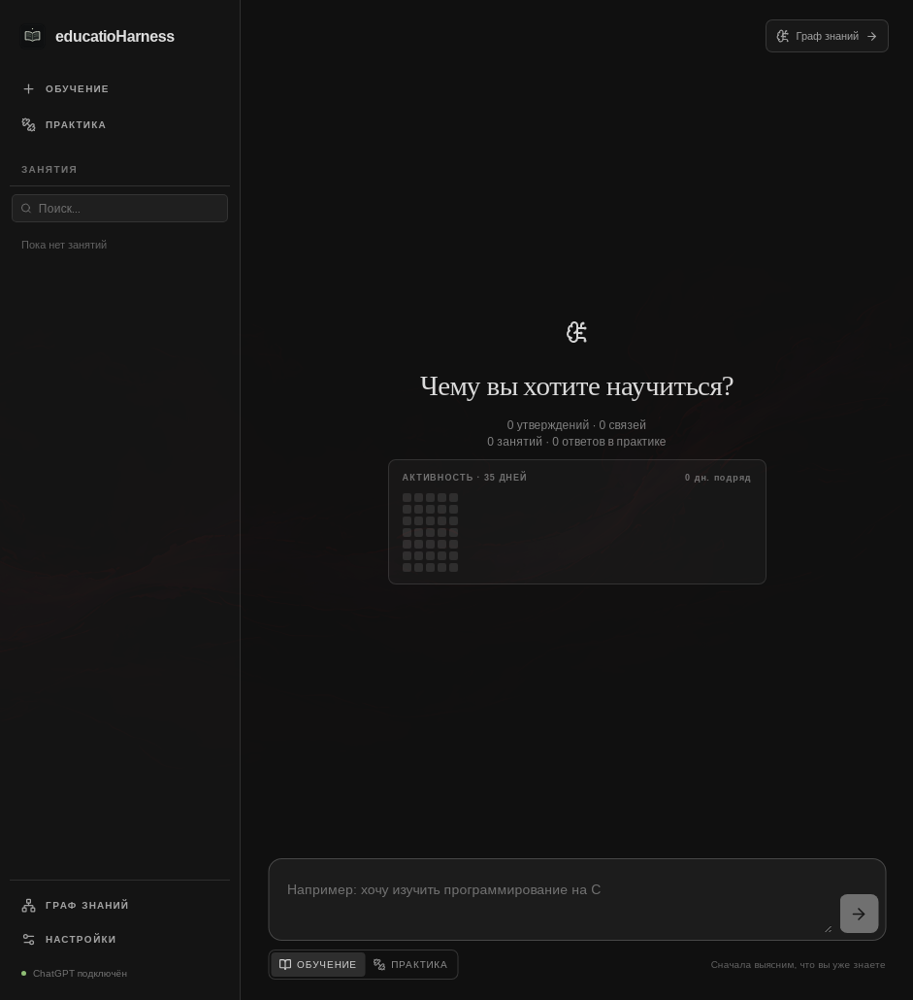

# educatioHarness

Локальное настольное приложение для персонального обучения с настоящими вызовами ИИ. Основа — Tauri 2, React, SQLite и отдельный Node.js runtime. Интерфейс на русском языке.



## Запуск на Linux, Windows и macOS

Нужны Node.js 22+, Rust stable и системные библиотеки Tauri 2. На Linux: WebKitGTK 4.1, GTK 3, libsoup 3, pkg-config и Secret Service (GNOME Keyring или KWallet). На Windows: Microsoft C++ Build Tools и WebView2; на macOS: Xcode Command Line Tools. Подробнее: [системные зависимости Tauri](https://v2.tauri.app/start/prerequisites/). Для ChatGPT приложение комплектуется официальным бинарником Codex и использует его штатный вход; существующая сессия `codex login` также доступна. Для альтернативы нужен OpenAI API-ключ.

```sh
npm install
npm run tauri dev
```

В проверенной Hyprland-сессии WebKitGTK не отрисовывал Wayland-окно из-за ошибки GBM. Приложение автоматически включает XWayland и программную отрисовку только в Hyprland; на других рабочих столах остаются обычные настройки GTK. Сборка runtime выполняется автоматически перед запуском.

После подключения ИИ введите цель прямо на главном экране, ответьте на диагностические вопросы, изучите план, выберите тему и продолжите диалог. Для той же цели можно открыть «Новое занятие»: учитель получит историю этой цели из прежних занятий, а чужие цели в контекст не попадут. «Практика» создаёт задания и сохраняет обратную связь. «Граф знаний» показывает извлечённые утверждения, их связи и исходные реплики с переходом к занятию. Компактная колонка занятий и минималистичный тёмный экран повторяют структуру LearnHarness; подписи и учебный сценарий — на русском. Данные находятся в локальном каталоге приложений ОС (`educatio-harness/educatio-harness.sqlite3`); ключ API хранится в Secret Service, macOS Keychain или Windows Credential Manager, а состояние входа ChatGPT — у официального Codex CLI.

В практике есть карточки на активное вспоминание: вопрос и разбор разделены, ответ проверяется моделью только после отправки. Кодовые задания открывают редактор CodeMirror с подсветкой, отступами и нумерацией строк; математические ответы показывают предпросмотр Markdown/KaTeX. Главный экран показывает состояние тем, карту активности за 35 дней и серию дней с занятиями или ответами. Это статистика действий, а не процент усвоения. Карточки и редактор используют настоящие модельные задания, не демонстрационные ответы.

В «Настройки → Перенос данных» можно экспортировать локальные занятия в `.sqlite3` и импортировать их на другом компьютере. Перед импортом приложение проверяет целостность и версию файла, показывает количество целей/занятий/ответов, спрашивает подтверждение и автоматически сохраняет прежнюю базу в локальном каталоге. Импорт заменяет текущие данные. Ключ API и сессия ChatGPT не экспортируются; каталоги пользовательских навыков после импорта нужно выбрать заново. Архив может содержать личные ответы — храните его как приватный файл.

Там же есть экспорт в Obsidian: выберите каталог хранилища, и приложение создаст отдельную папку с Markdown-заметками по целям, темам и утверждениям графа. Существующие заметки не перезаписываются. Это односторонний экспорт, не двусторонняя синхронизация.

В настройках модель выбирается кнопками: для ChatGPT — автоматический выбор Codex или проверенный Sol; для OpenAI API — Sol, Terra либо Luna. Доступность конкретной модели зависит от аккаунта; переключение не обещает доступ, а тест подключения выполняет реальный запрос.

## Проверки и сборка

```sh
npm run typecheck
npm test
cargo test --manifest-path src-tauri/Cargo.toml
npm run desktop:build
```

`desktop:build` собирает исполняемые Node.js и официальный Codex sidecar для текущего Rust host: на Linux — `.deb` и AppImage, на Windows — NSIS `.exe`, на macOS — `.app` и `.dmg`. Для RPM используйте `npm run desktop:build:rpm`. [CI](.github/workflows/desktop.yml) собирает все три платформы; сборка другой архитектуры должна выполняться на соответствующем host, простое копирование Node.exe/бинарника Codex для cross-compile не годится. Исходники LearnHarness в `.references/learnharness` исключены из сборки. Codex запускается с `read-only`, без сетевых инструментов и с запретом запросов на повышенные права. Это не полная файловая изоляция: встроенные инструменты Codex могут читать доступные процессу локальные файлы. OpenAI Responses API в приложении вызывается без локальных инструментов.

## Документация

- [Архитектура](docs/architecture.md)
- [Разработка](docs/development.md)
- [Навыки](docs/skills.md)
- [Повторное использование LearnHarness](docs/upstream-reuse.md)
- [Исследование и следующие функции](docs/product-roadmap.md)

Проект использует идеи и адаптированные формулировки LearnHarness, лицензированного AGPL-3.0-only. См. [LICENSE](LICENSE) и [upstream-reuse.md](docs/upstream-reuse.md).

## Ограничения

Этот MVP запускает отдельный Node.js процесс на запрос. Запрос можно отменить; потоковые события отображаются как прогресс, но текст структурированного ответа показывается только после проверки схемы, чтобы не раскрывать решения заданий раньше времени. Оценка упражнений моделью — объяснённое суждение, а не формальное доказательство; кодовые ответы не исполняются. Для API-ключа нужен работающий системный менеджер секретов; вход с действительным API-ключом пока не проверен, а в проверенном Arch-окружении сам `gnome-keyring-daemon` иногда аварийно завершался (причинная связь с приложением не установлена). Дополнительные каталоги навыков доступны в настройках; перенос папки данных пока не настраивается. Экспорт/импорт поддерживается на desktop, но не является облачной синхронизацией. Мобильные приложения пока не собираются: Tauri 2 поддерживает Android/iOS, однако используемый Node/Codex sidecar требует отдельной мобильной архитектуры. Пакеты Windows/macOS и RPM проверяются CI, но полноценный интерактивный прогон на этих ОС ещё не выполнен. На macOS локальная сборка подписывается ad-hoc; для свободного распространения потребуется Apple Developer ID и notarization. Если у вас уже были занятия в прежней тестовой версии, приложение автоматически откроет её базу данных.
